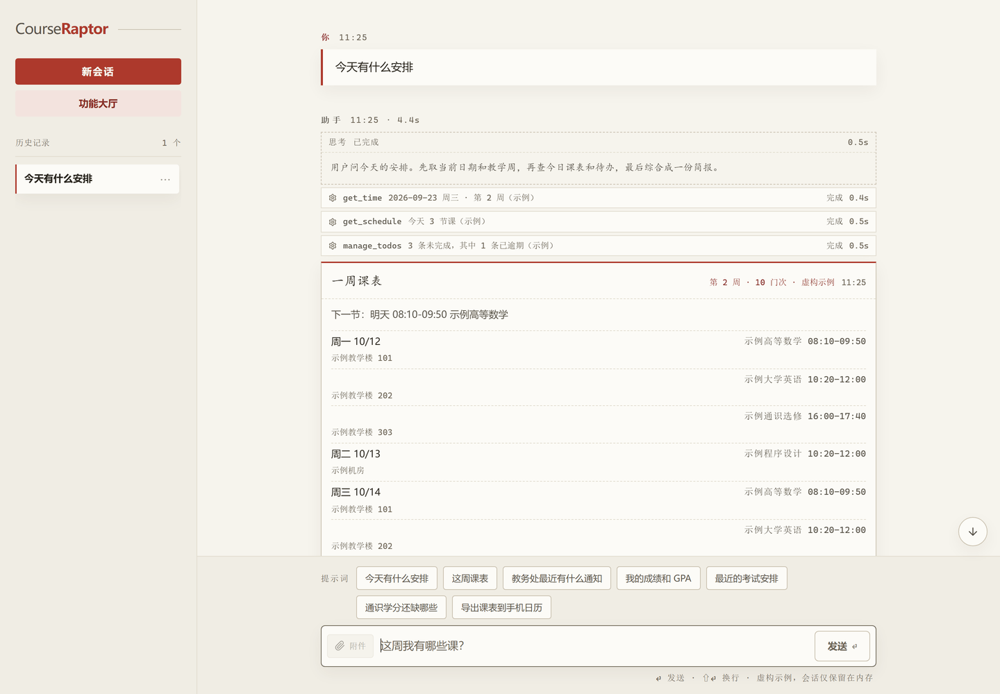
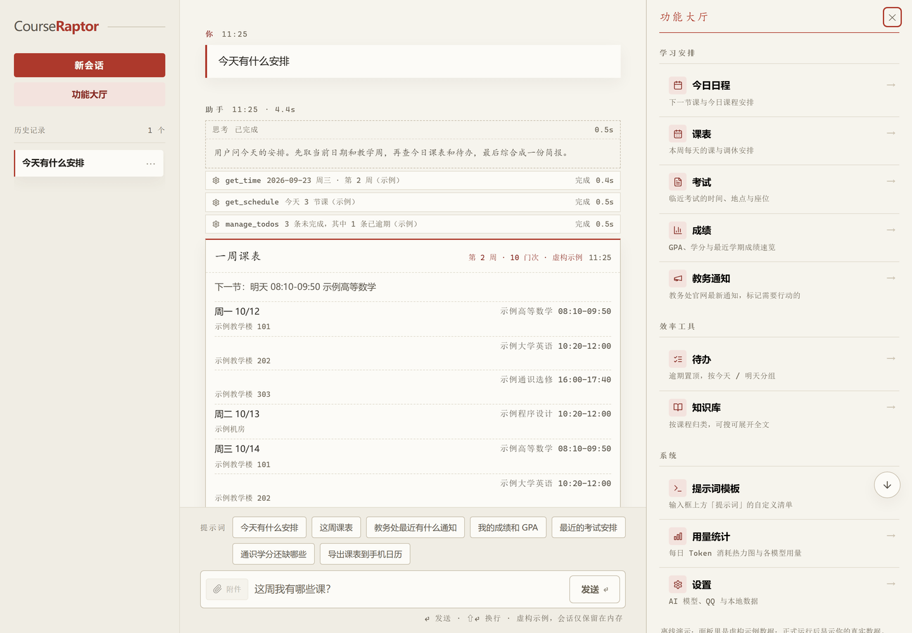

<div align="center">


# CourseRaptor

### Campus life, one sentence.

**An open-source conversational campus agent** — import your timetable once, then ask "what's my week", "what do I have to do today", "what should I revise" in one chat.<br>
Local-first: credentials are encrypted on your own machine, nothing goes through a third party, no telemetry.

[](https://github.com/Health-525/courseraptor/actions/workflows/ci.yml)
[](https://github.com/Health-525/courseraptor/releases/latest)
[](LICENSE)
[](https://github.com/Health-525/courseraptor)

[简体中文](README.md) · **English**

[Screenshots](#screenshots) · [What it does](#what-it-does) · [Install](#install) · [Privacy](#privacy-and-security) · [Architecture](#architecture) · [Docs](#docs) · [FAQ](#faq)

> ⚠️ **Independent, unofficial project.** The product interface and most documentation are in Chinese; this English overview is for developers who want to understand or contribute. The [Chinese README](README.md) is the authoritative, fully detailed version.

</div>

---

## Screenshots

> Captured in offline demo mode (`npm run demo`) — all data is fictional, no real timetable, grades or conversations.

**Web chat** — ask once; the reasoning, every tool call and the conclusion stay visible:

<p align="center"></p>

**Feature hall** — ten panels (today, timetable, exams, grades, notices, todos, knowledge base, prompt templates, usage stats, settings) live in one drawer:

<p align="center"></p>

<details>
<summary><b>Today view</b> (long screenshot: timetable grid, exams, todos and notes on one screen)</summary>

<p align="center"></p>

</details>

## What it does

| Student question | What happens |
|---|---|
| Where are my classes this week? What's on today? | Import your timetable once (paste text, or upload Excel/CSV/PDF/Word/TXT); query any teaching week including odd/even weeks and recorded schedule adjustments. The today view cross-references it with your todos |
| Can I move Wednesday's class to Friday? | Conversational schedule editing: change time, room or teacher, add or drop a course — conflicts are reported first and every edit can be reverted to the original import |
| What am I supposed to be revising? | Notes settle into a knowledge base as you chat, filed under the real courses on your timetable, flomo-style |
| Can you work out my GPA? | Sandboxed JS (no network, no disk, time-boxed) — the model writes the code instead of doing arithmetic |
| Can this become a Word document? | Word, Excel, PowerPoint and PDF generation with cross-format conversion and native CJK font embedding |
| Will it remember things? | Two-tier memory: sessions resume across restarts, long-term facts are self-maintained — local JSON only, no database |
| Can I see it on my phone? | Export a semester of `.ics` for any calendar app, or render the timetable as an image |

## Capabilities

- **Timetable import** — any format in, structured schedule out; asks when unsure, shows a row-by-row preview before storing anything
- **Conversational schedule editing** — move, swap rooms, add or drop courses; conflicts surface first, snapshots let you revert
- **Files and tables** — reads local Word/PDF/Excel/Markdown with pagination and keyword lookup; large sheets are queried by row, not dumped into the model
- **Document generation** — Word/Excel/PDF/PowerPoint, with a code-driven slide deck preview in the browser
- **Knowledge base** — auto-filed by real course, browsable with tags, search and a 16-week heat strip
- **Todos and reminders** — synced across entrances, desktop notifications plus QQ push on due dates, `.ics` export
- **Two-tier memory** — cross-restart sessions and self-maintained long-term facts
- **Study coach** — OpenMAIC learning skills (Feynman, exercise diagnosis, UbD, spaced review) loaded on demand, one at a time
- **One kernel, five entrances** — terminal TUI, local web UI, desktop app (Electron shell, double-click), QQ official bot (allowlist), and an [Obsidian sidebar plugin](obsidian/README.md), all sharing one kernel and one memory store
- **Bring your own model key** — 12 built-in Chinese providers (DeepSeek by default) plus any OpenAI-compatible endpoint; each key is encrypted separately and hot-swapped
- **Zero-credential demo** — `npm run demo` runs on fictional data with scripted answers: no credentials, no model calls, nothing persisted
- **19 tools out of the box** — timetables, files, documents, sandboxed computation, memory, knowledge base, todos, pomodoro and settings

See [capabilities](docs/capabilities.md) for parameters, timings and environment variables.

## Install

> **Requirements**: Windows 10/11, macOS 12+ or Linux (glibc 2.28+). **Only running from source needs Node.js ≥ 24** — the installer bundles a Node runtime, so there is nothing else to install.

### 1. Installer (recommended for students)

Grab a package from [Releases](https://github.com/Health-525/courseraptor/releases/latest) (~100 MB download):

- **`portable-win-x64.exe`** — double-click and go. It unpacks a `CourseRaptor` folder next to the exe (≈290 MB, runtime included), then opens instantly; deleting the folder uninstalls it. Upgrading means dropping the new exe into the same folder — accounts, memory and data are kept
- **`desktop-win-x64-setup.exe`** — standard installer: tray, native notifications, in-app auto-update
- **`portable-win-x64.zip`** — portable build; unzip and run `start.bat`

The app opens straight into the interface. Add your model API key in **Feature hall → Settings** (DeepSeek by default; other providers can be switched under **Settings → AI models**). Keys are encrypted locally and remembered.

### 2. Try it without credentials

```bash
git clone https://github.com/Health-525/courseraptor.git
cd courseraptor
npm install
npm run demo
```

Open the URL printed in the terminal (normally `http://127.0.0.1:3211`). The demo uses **fictional data and scripted responses**: it does not read credentials, contact an AI provider, or persist conversations. Press `Ctrl+C` to stop.

To see a real model analyse the same fictional data, run `npm run demo:live` instead (requires `DEEPSEEK_API_KEY` in the environment or the project `.env`; API usage may incur charges). Without a key it falls back to the scripted demo.

### 3. From source (developers)

```bash
git clone https://github.com/Health-525/courseraptor.git
cd courseraptor
npm install            # Node.js >= 24

npm link               # registers the global command (once)
raptor                 # or: npm run dev
```

Common scripts: `npm run doctor` (environment self-check) · `npm test` (node:test) · `npm run test:coverage` (with coverage floor) · `npm run typecheck && npm run lint` (types + Biome) · `npm run desktop:dev` (desktop development, see [`desktop/README.md`](desktop/README.md)).

### 4. Standalone skill packages

Two skill packages ship in the repo, independent of any school: copy them into `~/.claude/skills/`, `~/.zcode/skills/` or similar to reuse them with other agents.

- [`skills/export-schedule/`](skills/export-schedule/) — renders the cached timetable to an image for chat platforms
- [`skills/feynman-learning/`](skills/feynman-learning/) and friends — OpenMAIC learning skills (MIT), loaded on demand via `read_skill`

## Privacy and security

- **Everything is local** — file parsing, document generation, memory and the knowledge base all run on your machine; `src/` is fully open so every request, file access and encryption step can be read
- **Credentials** — API keys and the QQ bot secret are encrypted with AES-256-GCM into `credentials.enc`, bound to a machine fingerprint; a copied file will not decrypt elsewhere
- **Network boundary** — the web server listens on `127.0.0.1` only, validates Host/Origin, requires a CSRF token for writes and only accepts `application/json`
- **Execution boundary** — sandboxed JS has no network, no disk and a time limit; the anonymous install-statistics server is retired and running from source never reports (`RAPTOR_NO_TELEMETRY=1` disables legacy pings)
- **Local hosting is not the same as offline** — prompts and relevant query results are sent to the model provider you configure; the optional cloud parser is used only for public web pages

## Architecture

<p align="center">
  <picture>
    <source media="(prefers-color-scheme: dark)" srcset="docs/courseraptor-architecture.png">
    
  </picture>
</p>

- **Agent runtime** — Vercel AI SDK v7 (`ToolLoopAgent`, plus `runAgentTUI` for the terminal)
- **LLM** — DeepSeek by default (`deepseek-flash`, a.k.a. V4.1-Flash), switchable to 11 more Chinese providers or a custom OpenAI-compatible endpoint; keys stored and hot-swapped independently
- **Layering** — dependencies point inward only (`local → channels → core`); the kernel never imports a concrete implementation, and cross-layer needs go through port injection, enforced by `npm run verify:imports` in CI
- **Storage** — local JSON files only (`data/`, `session.json`, `memory.json`, `credentials.enc`); no database, no cloud sync

```
├── bin/raptor.cjs      # Global CLI entry
├── docs/               # Docs and brand assets
├── skills/             # Standalone skill packages
├── obsidian/           # Obsidian plugin (own npm project)
├── desktop/            # Desktop app (Electron shell, own npm project)
├── landing/            # Landing page (React + Vite, GitHub Pages)
├── src/
│   ├── core/           # Kernel: agent, memory, calendar, documents, attachments, knowledge + tools
│   └── channels/web/   # Web UI
└── local/              # Entrypoints: cli (TUI), qq (bot bridge), demo
```

### Build with us

Beyond the student tool, the repo is a working reference for local-first agents — every pattern below ships in daily use, backed by tests, free to lift under the MIT license (see [LICENSE](LICENSE)):

- **Agent loop** — Vercel AI SDK v7 `ToolLoopAgent` + `runAgentTUI` driving 19 tools across multi-turn loops — [`src/core/agent.ts`](src/core/agent.ts)
- **Kernel isolation** — the kernel only talks to ports it defines itself; dependency direction is enforced in CI — [`src/core/school.ts`](src/core/school.ts)
- **Multi-provider model layer** — a plain-data provider registry plus one model factory; 12 Chinese providers plus custom OpenAI-compatible endpoints — [`src/core/providers.ts`](src/core/providers.ts)
- **Two-tier memory** — cross-restart sessions plus self-maintained long-term facts, local JSON only — [`src/core/memory/`](src/core/memory/)
- **Local-first security** — AES-256-GCM credentials bound to a machine fingerprint, loopback-only web with Origin/CSRF checks, network-less sandboxed JS — [`src/core/credentials.ts`](src/core/credentials.ts)
- **Engineering floor** — TypeScript `strict`, node:test with a coverage floor, Biome, dual-OS CI — [`tsconfig.json`](tsconfig.json) · [`.github/workflows/ci.yml`](.github/workflows/ci.yml)

```bash
npm run typecheck
npm run lint
npm test
```

## Docs

- [Student guide (中文)](docs/student-guide.md) — step-by-step setup with screenshots
- [Capabilities](docs/capabilities.md) — tool parameters, timings, environment variables
- [Configuration reference](docs/configuration.md) — environment variables, credentials, QQ bot
- [Obsidian plugin](obsidian/README.md) — sidebar chat, schedule and todo insertion
- [Roadmap](docs/roadmap.md) · [Contributing](CONTRIBUTING.md) · [Security](SECURITY.md) · [Code of Conduct](CODE_OF_CONDUCT.md)

## FAQ

<details>
<summary><b>The installer does nothing, or my antivirus blocks it</b></summary>

The packages are unsigned (the exe is a self-extracting launcher; `runtime\node.exe` is the official Node runtime). Choose "More info → Run anyway" in SmartScreen, or add the install folder to your antivirus allowlist.
</details>

<details>
<summary><b>No model API key yet — can I still try it?</b></summary>

Yes: run the offline demo (`npm run demo`) for the full interface with zero credentials. Live chatting needs your own key — DeepSeek by default, or 11 other Chinese providers, or any OpenAI-compatible endpoint. You can change it later under **Feature hall → Settings → AI models**.
</details>

<details>
<summary><b>The web page won't open, or the port is taken</b></summary>

Use the address printed at startup (default `http://127.0.0.1:3210`; a busy port is skipped automatically). If the page misbehaves after an upgrade, hard-refresh with `Ctrl+F5`.
</details>

<details>
<summary><b>Where is my data, and how do I remove it completely?</b></summary>

All on your machine: `data/`, `credentials.enc`, `session.json`, `memory.json`. The installer build is uninstalled by deleting the `CourseRaptor` folder; from source, run `npm unlink` and delete the project directory. See "uninstall and cleanup" in the [capabilities doc](docs/capabilities.md).
</details>

## Contributing

Bug reports, documentation fixes and concrete use cases all count. Start with [CONTRIBUTING.md](CONTRIBUTING.md); report security issues privately per [SECURITY.md](SECURITY.md). Questions and ideas are welcome in [Discussions](https://github.com/Health-525/courseraptor/discussions).

## Disclaimer

- Released under the [MIT License](LICENSE) and provided **"as is"**, without warranty of any kind, express or implied. This is an independent, unofficial project with no affiliation with or endorsement by any university.
- Use it **for personal learning, research and technical exchange only** — not for any commercial purpose. Users assume all risks arising from use of this tool; follow your school's rules.
- For decisions that matter (course enrolment, exam arrangements, graduation audits), always verify against your university's official channels.
- This project does **not** solve or bypass CAPTCHAs; attachments protected by one fail with an explicit message asking you to download them manually.

## License

[MIT](LICENSE) © jiangshu

<div align="center">

**🦖 CourseRaptor** · campus life, one sentence

[⬆ Back to top](#courseraptor) · [Chinese version](README.md)

</div>
