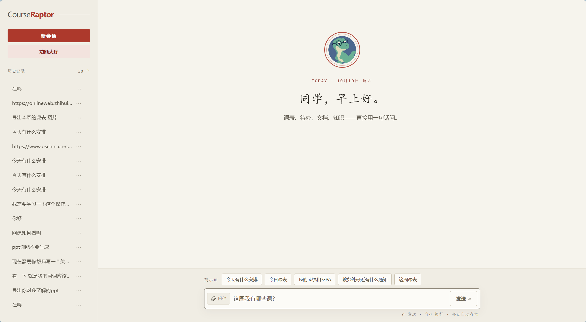

<div align="center">


# CourseRaptor

### Less time hunting through portals. More time for student life.

**An open-source conversational campus agent** — timetables, todos, a knowledge base, documents, and memory, all in one chat. A local-first personal school assistant (Vercel AI SDK v7 · four entrances, one kernel): import your timetable once and start asking, with everything staying on your own machine.

[简体中文](README.md) · **English**

[](https://github.com/Health-525/courseraptor/actions/workflows/ci.yml)
[](https://github.com/Health-525/courseraptor/releases/latest)
[](LICENSE)
[](https://github.com/Health-525/courseraptor)

[Try the demo](#try-it-without-credentials) · [Quick start](#use-your-own-model-api-key) · [Discuss](https://github.com/Health-525/courseraptor/discussions) · [Contribute](CONTRIBUTING.md)

</div>

CourseRaptor brings your timetable, todos, knowledge base, and document work into one conversational interface. Ask in the terminal, the browser, QQ, or an Obsidian sidebar — four entrances sharing one agent kernel and one memory store. Everything runs on your own machine: credentials are AES-256-GCM encrypted on disk, and it talks to your own model API key — DeepSeek by default, with 11 more built-in Chinese providers (Qwen, Zhipu GLM, Kimi, Doubao, Hunyuan, MiniMax, Step, ERNIE, Spark, SiliconFlow, China Mobile Cloud) plus custom OpenAI-compatible endpoints. Nothing is reported: the anonymous install-statistics server has been retired (legacy installers' once-every-24h pings go nowhere and are silently dropped; `RAPTOR_NO_TELEMETRY=1` disables them; running from source never reports).

If you are building agents yourself, the repo doubles as a reference implementation: how a `ToolLoopAgent` loop organizes dozens of tools, how the kernel stays decoupled from concrete external systems behind ports (dependency direction is enforced in CI by `npm run verify:imports`), and how a multi-provider model layer is assembled from a plain-data registry. See [Build with us](#build-with-us) below.

> ⚠️ **This is an independent, unofficial project.** The product interface and most documentation are in Chinese; this English overview helps developers understand and contribute to the project. The [Chinese README](README.md) is the authoritative, fully detailed version.

<p align="center">
  
</p>

> Demo and screenshots use fictional sample data (demo mode), never real academic records.

## What it does

| Student question | Available capability |
|---|---|
| Where are my classes this week? | Import your timetable once (paste the text or upload Excel/CSV/PDF/Word/TXT), then query any teaching week, including odd/even weeks and recorded schedule adjustments |
| What do I have to get done today? | A today view that cross-references your timetable with due todos, plus automatic desktop and QQ reminders |
| What am I supposed to be revising? | A study-coach mode: intuition before formalism, hints before answers; exam prep follows a "template → variation → full paper" arc |
| Can I use my phone calendar? | Local `.ics` export of a whole semester, import once into your calendar app |
| Can I turn this material into a document? | Local document/table reading and Word, Excel, PowerPoint, and PDF generation with cross-format conversion |
| Need actual math done? | Sandboxed JS (no network, no disk, time-boxed) — the model writes the code, the sandbox runs it |
| Will it remember things? | Two-tier memory: sessions resume across restarts, long-term facts are self-maintained |
| Where did I write down that formula? | A knowledge base that files notes by the courses on your timetable, with tags, search, and a 16-week heat strip |
| Can it help me study? | Study-coach mode with methods loaded on demand, so they never occupy the standing context |

The kernel ships **19 tools out of the box**, covering timetables, files and tables, document generation, sandboxed computation, memory, the knowledge base, todos, the study coach, the teaching-skill library, and settings. See [capabilities](docs/capabilities.md) for the full table.

## Try it without credentials

Install Node.js 24 or later, then:

```bash
git clone https://github.com/Health-525/courseraptor.git
cd courseraptor
npm ci
npm run doctor
npm run demo
```

Open the URL printed in the terminal, normally `http://127.0.0.1:3211`.

The demo uses **fictional data and scripted responses**. It does not read personal credentials, contact an AI provider, or persist conversations to disk. It demonstrates the interface, not live AI performance. Press `Ctrl+C` to stop.

To showcase real AI analysis with the same fictional data, run `npm run demo:live` instead. It answers with a real DeepSeek model (requires a `DEEPSEEK_API_KEY` in the environment or the project `.env`; API usage may incur charges) while every tool still returns fictional samples, so no account or personal data is involved. Without a key it falls back to the scripted offline demo.

## Use your own model API key

Windows users can grab a self-contained installer (bundled Node runtime, ~100 MB download) from [Releases](https://github.com/Health-525/courseraptor/releases/latest) — no development environment needed. From source, run `npm start` (or double-click `start.bat` on Windows). Follow the prompts to configure your model API key (DeepSeek by default; other providers can be switched in the web Settings panel). Provider API usage may incur charges.

The browser UI usually runs at `http://localhost:3210`; follow the actual startup address if that port is busy. Keep the terminal running. To change your API key securely, enter `/key` without arguments in the terminal.

## Architecture overview

- **Agent runtime**: Vercel AI SDK v7 (`ToolLoopAgent` + `runAgentTUI` for terminal)
- **LLM**: DeepSeek by default (`deepseek-flash` / V4.1-Flash), switchable to 11 more Chinese providers or a custom OpenAI-compatible endpoint — each provider's key stored and hot-swapped independently
- **Web UI**: Single-page Node server (`src/channels/web/`) with push-panel layout, session history, and real-time tool result sync
- **Layering**: dependencies point inward only (`local → channels → core`); the kernel never imports a concrete implementation, and cross-layer needs go through port injection — enforced by `npm run verify:imports` in CI
- **Data storage**: Local JSON files only (`data/`, `session.json`, `memory.json`, `credentials.enc`); no database, no cloud sync

## Project structure (key directories)

```
├── bin/raptor.cjs        # Global CLI entry (npm link)
├── docs/                 # Assets & extended docs
├── skills/               # Bundled skill packages: timetable image export
│                         # learning skills + export-schedule
├── obsidian/             # Obsidian plugin (fourth entrance: sidebar chat +
│                         # today-schedule/todo insertion; own npm project)
├── src/
│   ├── core/             # Kernel: agent, memory, calendar, documents,
│   │                     # attachments, knowledge + generic tools
│   └── channels/web/     # Web UI: chat, hall, /today, /todos, /knowledge
└── local/                # Entrypoints: cli (TUI), qq (bot bridge), demo
```

## Boundaries that matter

- Local hosting does **not** mean fully offline processing: prompts and relevant query results are sent to the configured model provider.
- QQ users share the configured identity; the allowlist is not multi-student account isolation.
- Timetable import is read-and-confirm: the agent parses, asks when unsure, and shows an editable preview before anything is stored.
- Attachment parsing stays local; the optional cloud parser is used only for public web pages.

Share the repository URL or an inspected clean installation package, never your used project directory. See [privacy and security](SECURITY.md).

## Build with us

Beyond the student tool, the repo is a working reference for local-first agents — every pattern below ships in daily use, backed by tests, free to lift under the MIT license (see [LICENSE](LICENSE)):

- **Agent loop**: Vercel AI SDK v7 `ToolLoopAgent` + `runAgentTUI` driving dozens of tools across multi-turn loops — [`src/core/agent.ts`](src/core/agent.ts)
- **Kernel isolation**: the kernel (`src/core`) only talks to ports it defines itself and never imports a concrete implementation; dependency direction is enforced by `npm run verify:imports` — [`src/core/school.ts`](src/core/school.ts)
- **Multi-provider model layer**: a plain-data provider registry plus one model factory; 12 Chinese providers + custom OpenAI-compatible endpoints, keys encrypted independently and hot-swapped — [`src/core/providers.ts`](src/core/providers.ts)
- **Two-tier memory**: cross-restart session continuity plus self-maintained long-term facts, local JSON only — [`src/core/memory/`](src/core/memory/)
- **Local-first security**: AES-256-GCM credentials bound to the machine fingerprint, loopback-only web with Origin/CSRF checks, network-less sandboxed JS — [`src/core/credentials.ts`](src/core/credentials.ts)
- **Engineering floor**: TypeScript `strict`, node:test with a coverage floor, Biome, dual-OS CI — [`tsconfig.json`](tsconfig.json) · [`.github/workflows/ci.yml`](.github/workflows/ci.yml)

```bash
npm run typecheck
npm run lint
npm test
```

[Contributing](CONTRIBUTING.md) · [Roadmap](docs/roadmap.md) · [Capabilities](docs/capabilities.md) · [Student guide](docs/student-guide.md)

Found it useful? A star, a reproducible issue, or a concrete student use case helps the project improve. Built something of your own on these patterns? Share it in [Discussions](https://github.com/Health-525/courseraptor/discussions).

## Disclaimer

- CourseRaptor is released under the [MIT License](LICENSE) and provided **"as is"**, without warranty of any kind, express or implied. This is an independent, unofficial project with no affiliation with or endorsement by any university.
- Use it **for personal learning, research, and technical exchange only** — not for any commercial purpose. Users assume all risks arising from use of this tool; follow your school's rules.
- For decisions that matter (course enrollment, exam arrangements, graduation audits), always verify against your university's official channels.

Released under the [MIT License](LICENSE).
