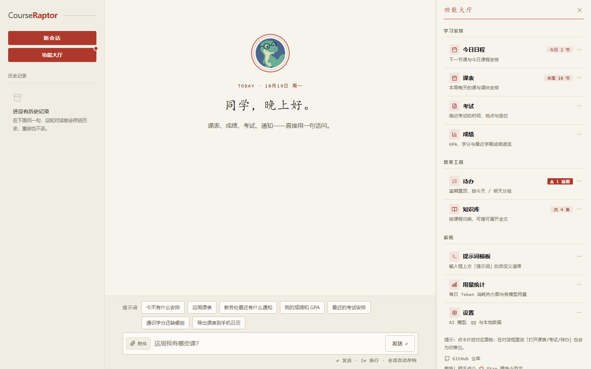
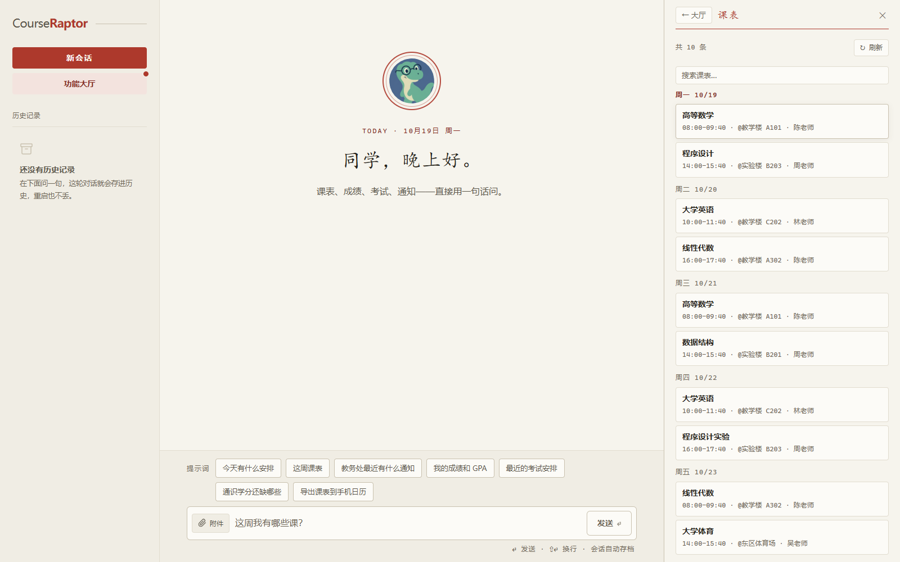
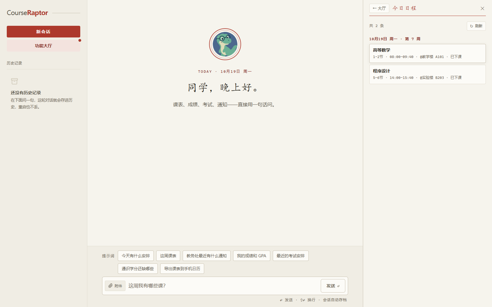
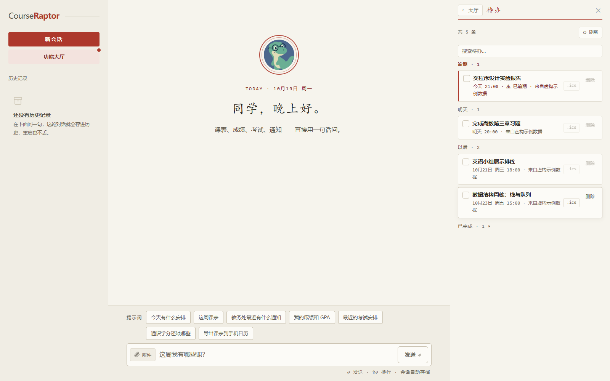
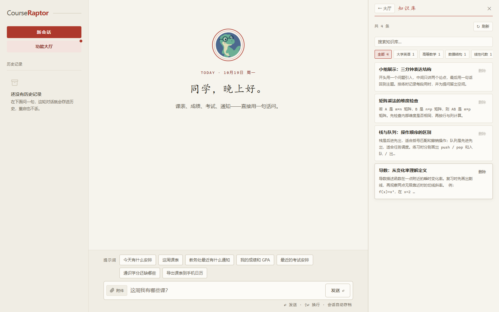

<div align="center">


<h1>CourseRaptor</h1>

**面向大学生的本地优先 AI 学习工作台**

把课表、待办和学习资料，交给同一个助手。

[](https://github.com/Health-525/courseraptor/actions/workflows/ci.yml)
[](https://github.com/Health-525/courseraptor/releases/latest)
[](LICENSE)

[**下载 Windows 版**](https://github.com/Health-525/courseraptor/releases/latest) · [快速上手](#快速上手) · [功能介绍](#功能介绍) · [使用文档](#文档与贡献) · [English](README.en.md)

</div>

「这周周三在哪上课？」「记一下，周五下午三点前交实验报告。」

CourseRaptor 将你导入的课表、记录的待办和保存的知识放在一起。可以直接对话，也可以在功能大厅查看课表、今日安排、待办和知识库。

> **使用前了解：**学习记录与生成文件保存在本机；正式 AI 对话需要自己的模型 API Key，相关内容会发送到所选模型服务，并可能产生调用费用。

## 界面预览

左侧管理会话，中间与 AI 对话，右侧功能大厅集中查看课表、待办和学习资料。

<p align="center">
  
  <br />
  <sub>离线演示界面 · 使用虚构数据 · 未调用 AI</sub>
</p>

## 功能介绍

<a id="能帮你做什么"></a>

| 能力 | 你可以做什么 |
| :--- | :--- |
| **课表与日历** | 按教学周查询课程、时间和地点，调整本地课表，导出 SVG / PNG 图片或 `.ics` 日历。 |
| **待办与提醒** | 用一句话记录截止事项，查询、修改或完成待办；程序运行时支持到期提醒。 |
| **今日安排** | 结合课表和待办整理当天计划，也可直接打开功能大厅查看。 |
| **知识与复习** | 按课程保存知识点，使用费曼学习法、螺旋复习等学习技能，跨会话保留重要记忆。 |
| **课程材料** | 阅读 PDF、Word、表格等附件，筛选和计算数据，生成 Word、Excel、PDF 或转换成 PPT。 |
| **多种入口** | 通过网页、终端 TUI 使用；另行配置后，可接入 QQ 机器人和 Obsidian 插件。 |

**不需要先适配学校，就能导入课表开始使用。** 公开仓库默认提供手动导入模式；在线成绩、考试和教务通知查询需要对应的学校适配器，当前公开仓库不随附在线适配器。

<details>
<summary>界面一览：课表、今日安排、待办与知识库</summary>

<a id="界面一览"></a>

以下面板均在右侧功能大厅内打开。截图使用虚构示例数据，点击标题可查看原图。

| [周课表](docs/screenshots/demo-schedule.png) | [今日安排](docs/screenshots/demo-today.png) |
| :---: | :---: |
|  |  |
| **[截止待办](docs/screenshots/demo-todos.png)** | **[课程知识库](docs/screenshots/demo-knowledge.png)** |
|  |  |

</details>

<details>
<summary>扩展能力：AI 新闻</summary>

源码 `main` 已接入 [AI 新闻技能](skills/ai-news/SKILL.md)，支持带来源的中文日报、突发简报和本地采集历史查询，额外需要 **Python 3.11+**。按需触发，不会在后台定时推送；首次采集访问公开来源，当天后续请求复用快照。安装包是否包含此能力，以对应发布说明为准。见[配置参考](docs/configuration.md#ai-新闻技能)。

</details>

## 快速上手

<a id="下载与运行要求"></a>

### 1. 选择运行方式

| 运行方式 | 环境要求 | 获取方式 |
| :--- | :--- | :--- |
| **Windows 桌面版 · 推荐** | Windows 10/11 x64，已内置 Node.js | [下载最新版](https://github.com/Health-525/courseraptor/releases/latest)，选择 `desktop-win-x64-setup.exe` 结尾的安装包。 |
| Windows 便携版 | Windows x64，已内置 Node.js | 同一发布页选择 `portable-win-x64.exe` 或 `.zip` 结尾的文件。 |
| 源码运行 | Windows / macOS / Linux，Node.js 24+、Git | 按[源码与离线演示](#源码与离线演示)启动。 |

macOS 和 Linux 请使用源码版。发布页底部的 **Source code** 是源码压缩包，不是 Windows 安装器。

### 2. 配置模型，导入课表

<a id="第一次使用"></a>

1. **配置模型。** 启动应用，在「功能大厅 → 设置 → AI 模型」填写自己的 API Key，保存并检测连接。默认支持 DeepSeek，也可选择其他内置厂商或自定义兼容端点。
2. **导入课表。** 在设置中选择「导入 / 重新导入课表」，粘贴文字，或上传 Excel、CSV、PDF、Word、TXT。核对预览中的周次、节次和地点，确认后保存。
3. **试一条查询和一条待办。** 问「这周课表」，核对一门课；再说「记一下，周五下午三点前交实验报告」，检查待办的具体日期和时间。

暂时没有 API Key？可以先运行[离线演示](#源码与离线演示)，了解界面与操作。详细步骤见[同学使用指南](docs/student-guide.md)。

### 3. 从这些问题开始

| 想做的事 | 直接这样说 |
| :--- | :--- |
| 查上课地点 | 这周周三有哪些课？按时间和地点列出来。 |
| 记截止日期 | 记一下，周五下午三点前交实验报告。 |
| 整理今日安排 | 结合课表和待办，整理一下今天的安排。 |
| 导出课表 | 导出本周课表图片。 |
| 保存知识点 | 记下这个知识点，归到高等数学。 |

提醒需要主程序保持运行并具备通知权限；QQ 推送需额外配置机器人和接收对象。更多用法见[完整能力](docs/capabilities.md)。

## 源码与离线演示

**前置要求：Node.js 24+、Git，以及首次安装依赖所需的网络连接。**

```bash
git clone https://github.com/Health-525/courseraptor.git
cd "courseraptor"
npm ci
npm run demo
```

打开终端打印的地址，通常为 `http://127.0.0.1:3211`。离线演示使用虚构数据和固定回答，**无需 Key、不调用 AI、不读取个人凭证**，会话仅保留在内存。按 `Ctrl+C` 退出。

准备正式使用时运行：

```bash
npm run doctor
npm start
```

在界面中配置模型并导入课表。网页通常位于 `http://127.0.0.1:3210`，以启动提示为准，使用期间保持主程序运行。

<details>
<summary>已有模型 Key，想用示例数据体验真实回答？</summary>

已有 DeepSeek Key 时，可运行 `npm run demo:live`。它使用虚构工具数据和真实模型回答，可能产生 API 调用费用；普通 `npm run demo` 只展示界面与固定流程，不能用于评价模型表现。

</details>

## 常见问题

<details>
<summary>课表解析不准，或者学校不在列表里怎么办？</summary>

直接使用课表导入，无需学校适配器。尽量提供课程名、星期、节次、周次和地点，在保存前逐行校正，并按学校校历核对开学日期。导入课表不会自动获得在线成绩、考试或教务通知查询能力。

</details>

<details>
<summary>没有 API Key 能用吗？手机上可以用吗？</summary>

无需 Key 即可运行离线演示；正式 AI 对话需要自己的模型服务配置。已有课表可直接在功能大厅查看，无需每次发起对话。

目前没有安装即用的手机 App，也不提供默认跨设备云同步。你可以把导出的课表图片传到手机，或将 `.ics` 文件导入手机日历。

</details>

<details>
<summary>如何保存数据和升级？</summary>

个人记录在本机保存，备份与数据目录说明见[配置参考](docs/configuration.md)和[隐私与安全](SECURITY.md)。分享项目时请发仓库链接或干净安装包，不要转发已使用过的完整目录。

Windows 桌面安装版支持自动更新，也可下载新版覆盖安装；便携版按发布说明更新。源码版更新代码后，按变更需要安装依赖并重启。个人使用无需配置终端 `/update` 所需的更新服务。

</details>

<details>
<summary>启动、模型连接或文件处理遇到问题怎么办？</summary>

先看[同学指南的常见问题](docs/student-guide.md#常见问题)与[配置参考](docs/configuration.md)。源码版可运行 `npm run doctor` 检查本地前提，它不检查模型账户余额。单个附件上限为 25 MB；中文 PDF 输出需要可用的中文字体。

Windows 安装包未做代码签名，可能出现未知发布者提示，请核对下载来源。可复现的问题请提交 [Issue](https://github.com/Health-525/courseraptor/issues/new/choose)，附脱敏后的最小复现，不要上传密码、Key 或完整个人日志。

</details>

## 数据与使用边界

- **记录保存在本机。** 会话、课表、待办、知识库和生成文件在本地保存；AI 回答所需的提示词、相关查询结果和附件内容会发送到所选模型服务。本地优先不等于完全离线。
- **凭证需要妥善保管。** 模型 Key 支持本地加密保存；不要公开个人配置、凭证或完整使用目录。网络访问与凭证处理细节见 [SECURITY.md](SECURITY.md)。
- **每个人使用自己的数据。** 网页、终端、QQ 等入口复用同一台电脑上的状态；QQ 白名单不提供多用户数据隔离，多人独立使用请各自安装和配置。
- **重要结果需要核对。** 本项目是非官方个人工具。课程变更、考试和截止时间以学校正式渠道为准，解析结果与生成内容应由使用者确认。

## 开发指南

<a id="给开发者"></a>

CourseRaptor 也可作为本地 Agent 参考项目：使用 **TypeScript + Vercel AI SDK** 构建多轮工具调用，由 tsx 直接运行。依赖方向为 `local → channels → core`，通过 CI 检查；个人状态主要使用本地 JSON，AI 新闻另用本地 SQLite，无需数据库服务。

| 关注方向 | 代码入口 |
| :--- | :--- |
| 模型与工具调用 | [`src/core/agent.ts`](src/core/agent.ts) · [`src/core/tools/`](src/core/tools/) |
| 模型厂商与端点 | [`src/core/providers.ts`](src/core/providers.ts) |
| 会话与长期记忆 | [`src/core/memory/`](src/core/memory/) |
| 学校能力边界 | [`src/core/school.ts`](src/core/school.ts) |
| 按需加载技能 | [`skills/`](skills/) · [`skill-library.ts`](src/core/tools/skill-library.ts) |
| 桌面与插件入口 | [`desktop/`](desktop/) · [`obsidian/`](obsidian/) |

```bash
npm run doctor          # 本地环境体检
npm run check           # 类型、代码规范、分层检查
npm run test:coverage   # 全量测试与覆盖率门禁
npm run package:skill   # 将技能打包为可分发 zip
```

CI 在 Ubuntu 与 Windows 上执行检查。技能分发和来源说明见[课表导出技能](skills/export-schedule/package/README.md)、[学习技能](skills/openmaic/)与 [AI 新闻引擎说明](scripts/ai-news/NOTICE.md)。

## 文档与贡献

<a id="文档与参与贡献"></a>
<a id="参与贡献"></a>

| 文档 | 内容 |
| :--- | :--- |
| [同学使用指南](docs/student-guide.md) | 安装、首次使用与常见问题 |
| [配置参考](docs/configuration.md) | 模型配置与可选功能 |
| [完整能力](docs/capabilities.md) | 工具能力与使用场景 |
| [Obsidian 插件](obsidian/README.md) | 在笔记中使用助手 |
| [路线图](docs/roadmap.md) | 项目方向与后续计划 |
| [贡献指南](CONTRIBUTING.md) | 参与代码与文档改进 |

欢迎通过 [Issue](https://github.com/Health-525/courseraptor/issues/new/choose) 反馈使用问题或建议，在 [Discussions](https://github.com/Health-525/courseraptor/discussions) 分享校园使用场景。如果它帮到了你，也欢迎 Star 或分享给需要的同学。

---

基于 [MIT](LICENSE) 许可证开源。非官方个人学习工具，按「现状」提供，不作任何明示或默示担保。
