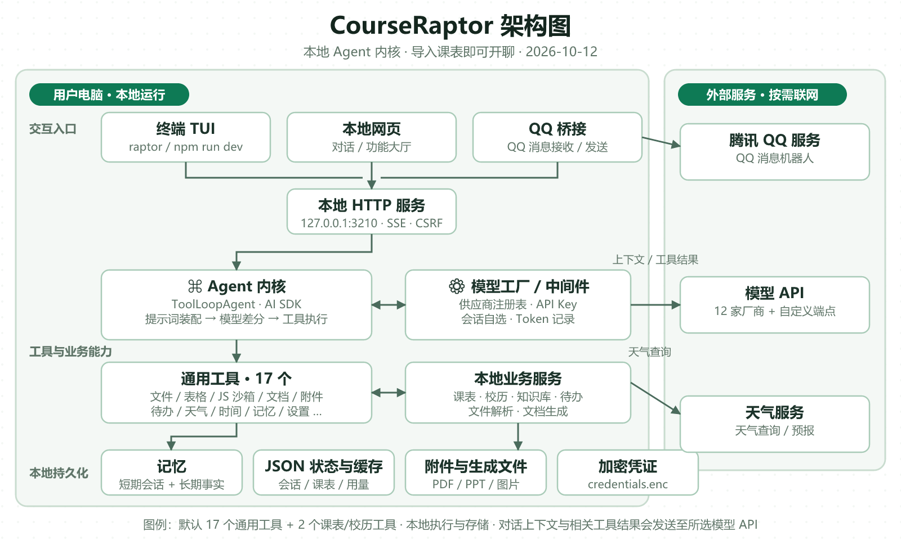

<div align="center">


# 🦖 CourseRaptor

**大学校园对话式 Agent** —— 课表 · 待办 · 知识库 · 文档 · 记忆，一句话搞定。<br>
本地优先的个人校园助手（Vercel AI SDK v7 · 四端入口）：导入课表即可开聊，所有数据都留在自己的电脑上。

[](https://github.com/Health-525/courseraptor/actions/workflows/ci.yml)
[](https://github.com/Health-525/courseraptor/releases/latest)
[](LICENSE)
[](https://github.com/Health-525/courseraptor)

[简体中文](README.md) · [English](README.en.md)

[界面预览](#界面预览) · [核心特性](#核心特性) · [快速开始](#快速开始) · [隐私与安全](#隐私与安全) · [项目架构](#项目架构) · [文档](#文档) · [常见问题](#常见问题)

**如果它帮到了你，希望帮我点个 [⭐ Star](https://github.com/Health-525/courseraptor)，让更多同学看到它**

</div>

---

散落在课表、待办里的信息，收进一句对话。

问「这周课表」「今天要干什么」「这周还有哪些要背的」——导入一次课表，之后日常安排、待办和复习计划都能一句话问出来。

- **四端一个内核** —— 终端敲 `raptor`、浏览器开 `localhost:3210`、QQ 里 @机器人、Obsidian 侧栏里问，共用同一份记忆
- **一切都在本机** —— 凭证加密存放，数据不经第三方，不上报遥测
- **模型接你自己的 Key** —— 默认 DeepSeek，共 12 家国内厂商可选，按量计费、用量透明
- **导入课表就能用** —— 粘贴课表文字或上传 Excel / CSV / PDF / Word，AI 解析成结构化课表，今日页、周课表与课表图片立刻可用

在写 Agent？也可以把它当参考实现读：多轮工具循环、内核与外部系统隔离、多厂商模型装配，每个设计都有源码与测试兜底——见 [工程样例](#给开发者一套可整体搬走的本地-agent-工程)。

---

## 界面预览

**网页对话** —— 浏览器打开 `http://localhost:3210` 即聊，思考过程与工具调用全程可见：

<p align="center"></p>

---

## 核心特性

开箱工具覆盖课表（查询与调课）、课表图、文件表格、文档生成、沙箱计算、记忆、知识库、待办、学习技能库（按需加载）与设置，配置好模型 Key 就能直接对话。完整参数、耗时、环境变量与工具清单见 [能力文档](docs/capabilities.md)。

- **课表导入** —— 粘贴或上传任意格式课表（文字 / Excel / CSV / PDF / Word），AI 解析成结构化课表；拿不准先追问、不瞎猜，预览逐行确认后入库，今日页、周课表与课表图片都基于它
- **文件与表格** —— 读本地 Word / PDF / Excel / Markdown，长文分页、关键词定位；千行大表按条件取行，不整本塞给模型
- **沙箱计算** —— JS 跑在无网络、无磁盘、限时限量的沙箱里，算绩点、统计学分这类事模型只写代码、不口算
- **文档生成** —— 一句话生成 Word / Excel / PDF；PPT 走代码化课件，网页端翻页预览，跨格式互转、中文字体原生内嵌
- **两层记忆** —— 会话跨重启续聊，长期事实自主维护（「上次说的报销截止是哪天」直接问）；全部本地 JSON、无数据库
- **知识库** —— 知识点在对话里自动沉淀、按课表真实课程归类；flomo 式独立页，发布框 + 标签侧栏 + 热力带
- **待办** —— 四端同步，到期桌面通知 + QQ 主动推送，可导出 `.ics`
- **学习辅导** —— 学习类对话按需加载 OpenMAIC 学习 skill（费曼 / 习题诊断 / UbD / 螺旋复习等），一次一篇
- **终端 · 网页 · QQ · Obsidian** —— 四个入口共享同一内核与记忆：TUI 首屏即今日课表、网页功能大厅、QQ 官方机器人（白名单制、零封号）、Obsidian 侧栏对话与日程插入笔记（[插件指南](obsidian/README.md)）
- **网页功能大厅** —— 今日日程 / 课表 / 待办 / 知识库 / 番茄钟 / 用量统计等面板，每个面板就在大厅抽屉里看全（2026-10 起不再跳独立整页）；会话搜索、改名、置顶；文件拖进输入框即上传
- **多厂商模型** —— 12 家国内厂商（默认 DeepSeek）+ 自定义 OpenAI 兼容端点：Key 独立加密保存、切换不丢，网页端下拉即切
- **还有** —— 天气与带伞穿衣建议、课表图片导出、零凭证离线演示（`npm run demo`）、自动更新

---

## 快速开始

三种用法按需选：**安装包**（推荐给同学，零开发环境）、**源码运行**（开发者）、**独立技能包**（给别的 agent 复用）。无论哪种，思考过程、工具调用与每轮问答都会归档进会话历史。

### 方式一：下载安装包（推荐给同学，无需任何开发环境）

到 [Releases](https://github.com/Health-525/courseraptor/releases/latest) 下载任一安装包（约 100 MB，已内置 Node 运行时，不用装 Node.js、也不用联网装依赖）。别下页面最底部 GitHub 自动生成的 Source code 包。

- **`portable-win-x64.exe`（最省事，推荐）**：双击即用。exe 放哪、程序就装到哪——首次双击在旁边释放 `CourseRaptor` 文件夹（解压后约 290 MB，含内置 Node 运行时与依赖）后直接进入对话；之后秒开，删文件夹即卸载。升级 = 新版 exe 放进原文件夹再双击，账号、记忆、数据全部保留
- **`portable-win-x64.zip`（绿色版）**：解压后双击文件夹里的 `start.bat`，适合 U 盘携带或机房电脑

启动不在终端提问，直接进入界面；模型 API Key（默认 DeepSeek，其他厂商在网页「设置 → AI 模型」里切换）在网页「功能大厅 → 设置」里填写，加密存本机、之后免填。

### 方式二：git 克隆（开发者）

```bash
git clone https://github.com/Health-525/courseraptor.git
cd courseraptor
npm install        # 需 Node.js ≥ 24

# 模型 Key（默认 DeepSeek）：cp .env.example .env 后编辑填入；其余 11 家厂商与自定义端点可在网页设置里配

npm link           # 注册全局命令（一次即可，任意目录可用）
raptor             # 启动；项目内也可 npm run dev
```

常用脚本：`npm run doctor`（环境自检）· `npm test`（node:test）· `npm run test:coverage`（同测试，带覆盖率门槛）· `npm run typecheck && npm run lint`（类型 + Biome 检查）· `npm run desktop:dev`（桌面版开发，见 [`desktop/README.md`](desktop/README.md)）。

### 先零门槛体验（可选）

还没配 API Key？完成上面的 clone 与 `npm install` 后，一行命令进入离线演示：

```bash
npm run demo
```

- **虚构示例数据 + 剧本式回答**：不读本机凭证、不调模型、对话不落盘
- 打开终端打印的地址（通常 `http://127.0.0.1:3211`），体验与正式版一致的界面和交互
- 想看真实 AI 对同样的虚构数据做分析：`.env` 配好 `DEEPSEEK_API_KEY` 后改跑 `npm run demo:live`（回复来自真实模型、工具仍返回虚构数据，API 用量可能产生费用；没配 Key 自动退回离线剧本）

### 方式三：独立技能包（给别的 agent 用）

下面两个独立技能包与学校无关、仓库已内置，可整份拷到 `~/.claude/skills/`、`~/.zcode/skills/` 等目录给别的 agent 用，或从 [Releases](https://github.com/Health-525/courseraptor/releases) 下载 zip：

- [`skills/export-schedule/`](skills/export-schedule/) —— 把课表缓存渲染成图片供下载，适配各平台聊天里直接发图看课表的场景（`npm run package:skill -- export-schedule` 构建）
- [`skills/feynman-learning/`](skills/feynman-learning/) 等 —— OpenMAIC 学习类 skill（平级存放，MIT）；agent 经 `read_skill` 按需加载。课表图见 [`skills/export-schedule/`](skills/export-schedule/) 与工具 `export_schedule_image`（详见 [能力文档](docs/capabilities.md)）

<details>
<summary><b>系统要求</b>（点开查看）</summary>

- **操作系统** —— Windows 10/11、macOS 12+、Linux (glibc 2.28+)
- **Node.js** —— ≥ 24（安装包已内置 Node 运行时，无需预装）
- **内存** —— ≥ 512 MB 可用（运行时约 150-300 MB）
- **磁盘** —— ≥ 300 MB（含运行时、依赖、本地数据）
- **网络** —— 首次配置需联网拉取模型 API（默认 DeepSeek，可换厂商）；之后可离线使用已缓存数据

</details>

---

## 隐私与安全

**数据只在本机**

- 文件解析、文档生成、记忆与知识库存储均在本机完成；`src/` 完全开源，所有网络请求、文件读写、加密逻辑均可直接阅读
- 敏感文件（`.env`、`session.json`、`memory.json`、`data/chat-sessions.json`）已被 `.gitignore` 排除，切勿提交或分享

**凭证与密钥**

- API Key、QQ 机器人密钥均经 AES-256-GCM 加密写入 `credentials.enc`，密钥绑定本机指纹，拷走的文件在别的电脑解不开

**网络与执行边界**

- 网页服务仅监听 `127.0.0.1`：Host / Origin 校验、写请求须携带 CSRF token、仅认 `application/json`
- 沙箱 JS 无网络无磁盘、超时截断；匿名装机统计服务已下线，源码运行从不上报（`RAPTOR_NO_TELEMETRY=1` 可关闭旧安装包的上报尝试）
- **「本地运行」不等于完全离线** —— 提示词与相关查询结果会发给你配置的模型服务商；附件云解析仅用于公开网站

---

## 项目架构

<p align="center">
  <!-- GitHub 按用户主题自动换图：暗色模式看深底版，浅色模式看白底版 -->
  <picture>
    <source media="(prefers-color-scheme: dark)" srcset="docs/courseraptor-architecture.png">
    
  </picture>
</p>

**本地优先（Local-first）**：交互入口、Agent 内核、两层记忆与知识库全部跑在本机，数据不出电脑；模型 API、天气等外部服务仅在查询时按需访问。

**技术栈**：[Vercel AI SDK v7](https://ai-sdk.dev)（`ToolLoopAgent` + `runAgentTUI`）· 模型层 DeepSeek 默认（`deepseek-flash`，即 V4.1-Flash）+ 11 家国内厂商 + 自定义 OpenAI 兼容端点，供应商注册表纯数据、模型工厂统一装配 · TypeScript + Node 内置 HTTP（网页端零框架）· Biome + node:test

**项目结构**（完整树见 [能力文档](docs/capabilities.md#-项目结构完整树)）：

```
├── bin/raptor.cjs      # 全局命令入口
├── docs/               # 文档与素材
├── skills/             # 独立技能包：课表图导出 / 元学习
├── obsidian/           # Obsidian 插件（第四端入口：侧栏对话 + 日程/待办插入笔记，独立 npm 工程）
├── desktop/            # 桌面版（Electron 薄壳：窗口/托盘/原生通知/自动更新，独立 npm 工程）
├── src/                # 公用核心（与运行形态无关）
│   ├── core/           # 内核：agent/记忆/日历/文档/附件/知识库等 + 通用工具
│   └── channels/       # 输出渠道：web（网页版）
└── local/              # 本地版入口：cli（终端 TUI）、qq（机器人）、demo（离线演示）
```

分层依赖单向向内：`local → channels → core`。`src/core/` 不 import 任何具体实现，跨层需求一律走端口注入，由 `npm run verify:imports` 在 CI 里钉死。

### 给开发者：一套可整体搬走的本地 Agent 工程

> 在找「Vercel AI SDK 的生产级完整例子」，或者「Agent 怎么接一堆外部系统而不失控」？这个仓库是一份答案：四端入口跑在真实用户的日常使用里，每个设计都有源码可查、有测试兜底，以 MIT 许可证开源，欢迎拆走复用（详见 [LICENSE](LICENSE)）。

- **Agent 主循环** —— Vercel AI SDK v7 `ToolLoopAgent` + `runAgentTUI`：数十个工具的多轮循环，思考与工具调用全程透出（[`src/core/agent.ts`](src/core/agent.ts)）
- **内核与外部系统解耦** —— 内核（`src/core`）只认自己定义的接口，不认识任何具体外部服务；依赖方向单向由 `npm run verify:imports` 门禁钉死，跨层需求一律走端口注入（[`src/core/school.ts`](src/core/school.ts)）
- **多模型厂商接入** —— 供应商注册表纯数据 + 模型工厂统一装配：12 家国内厂商 + 自定义 OpenAI 兼容端点，Key 独立加密、运行时热切（[`src/core/providers.ts`](src/core/providers.ts) · [`src/core/models.ts`](src/core/models.ts)）
- **工具层设计** —— 工具的参数与返回契约覆盖课表、文件、文档、日历、记忆、知识库等域，可渐进式挂载（[`src/core/tools/`](src/core/tools/)）
- **两层记忆** —— 会话跨重启续聊 + 长期事实自主维护，全部本地 JSON、无数据库（[`src/core/memory/`](src/core/memory/)）
- **多入口单内核** —— 终端 TUI / 本地网页 / QQ 机器人共享同一内核与记忆，Obsidian 插件（`obsidian/`）同样直连本机服务；另有独立技能包（课表图导出 / 元学习）可整份拷给别的 agent 用（[`src/channels/`](src/channels/) · [`local/`](local/) · [`obsidian/`](obsidian/) · [`skills/`](skills/)）
- **本地优先安全** —— 凭证 AES-256-GCM 绑定本机指纹；Web 仅回环监听 + Host/Origin/CSRF 校验；沙箱 JS 无网络无磁盘（[`src/core/credentials.ts`](src/core/credentials.ts) · [`src/core/sandbox-js.ts`](src/core/sandbox-js.ts)）
- **工程化底盘** —— TypeScript `strict` + node:test（覆盖率门槛只升不降）+ Biome + 双 OS 矩阵 CI（[`tsconfig.json`](tsconfig.json) · [`.github/workflows/ci.yml`](.github/workflows/ci.yml)）

---

## 文档

**我在用**

- [同学使用指南](docs/student-guide.md) —— 我是同学，想看图文上手指南
- [能力文档](docs/capabilities.md) —— 查工具参数、耗时、环境变量
- [配置参考](docs/configuration.md) —— 查环境变量、凭证、QQ 机器人等配置项
- [Obsidian 插件指南](obsidian/README.md) —— 在 Obsidian 里侧栏对话、插入日程与待办

**我在改**

- [路线图](docs/roadmap.md) —— 看做了什么、接下来做什么
- [贡献指南](CONTRIBUTING.md) · [安全说明](SECURITY.md) · [行为准则](CODE_OF_CONDUCT.md) —— 参与贡献 / 报安全问题 / 行为准则
- [GitHub Discussions](https://github.com/Health-525/courseraptor/discussions) —— 提问、交流、反馈

---

## 常见问题

**双击安装包没反应，或被系统 / 杀软拦截？**
安装包未做代码签名（exe 是自释放启动器、zip 里的 `runtime\node.exe` 是 Node 官方运行时），SmartScreen 弹窗选「更多信息 → 仍要运行」，或把安装 / 解压目录加入杀软信任区。

**没有模型 API Key，能先用吗？**
可以先跑上面的离线演示，零凭证体验界面。正式对话需要自己的 Key——默认 DeepSeek，也可换**其余 11 家国内厂商**（通义千问、智谱 GLM、Kimi、豆包、移动云等，共 12 家）任选一家，或填自定义 OpenAI 兼容端点；之后随时能在网页「功能大厅 → 设置 → AI 模型」里改。

**网页打不开，或提示端口被占用？**
以终端启动时打印的实际地址为准（默认 `http://127.0.0.1:3210`，被占用会自动换端口）；页面表现异常先 `Ctrl+F5` 强刷缓存。

**课表怎么导入？**
在网页「功能大厅 → 设置 → 本地数据」里点「导入 / 重新导入课表」，粘贴课表文字或上传 Excel / CSV / PDF / Word / TXT。AI 解析后给你逐行确认的预览，确认即入库。拿不准的字段它会先追问（最多 3 个问题）而不是瞎猜，导入时还会做时间冲突检测。导入后今日页、周课表、课表图片都以它为准。

**课表或学期对不上怎么办？**
开学日期按校历维护，未知学期按 9 月 / 3 月第一个周一估算并在界面上标注；放假 / 调休可以在对话里说一句，让它把安排落到本地，之后课表与日历导出自动叠加。

**我的数据都存在哪，怎么彻底删除？**
全部在本机：`data/`、`credentials.enc`、`session.json`、`memory.json` 等。安装包版删除 `CourseRaptor` 文件夹即净卸载；源码版先 `npm unlink` 再删项目目录，本地数据清理步骤见[能力文档](docs/capabilities.md)「卸载与清理」一节。

**怎么把 agent 挂到 QQ 上？**
走腾讯官方机器人路线（零封号）：网页「功能大厅 → 设置」填 AppID / AppSecret / 激活暗号即可上线，QQ 里发暗号完成授权；细节见[能力文档](docs/capabilities.md)「QQ 接入」一节。

更多问题欢迎到 [GitHub Discussions](https://github.com/Health-525/courseraptor/discussions) 提问。

---

## 免责声明与使用建议

- 本项目基于 [MIT 许可证](LICENSE) 开源，仅供个人学习、研究与技术交流使用，请勿用于任何商业用途或牟利场景；为非官方的独立开源项目，与任何学校官方无关、未获其授权或认可，按「现状」（AS IS）提供、**不作任何明示或默示的担保**，使用者需**自行承担全部风险**。
- 涉及选课、考试安排、毕业审核等重要决策时，请务必以学校官方系统与通知为准；因使用本工具产生的任何后果由使用者本人负责。
- **不做验证码识别**：本项目不识别、不绕过任何图形验证码。附件若受验证码保护，会明确失败并提示你在浏览器里手动下载——不做「绕过网站反自动化措施」这类事，也就没有相应风险。

---

<div align="center">

**🦖 CourseRaptor** · 让迅猛龙替你管好校园日常 · [MIT](LICENSE)

觉得好用？[点个 ⭐ Star](https://github.com/Health-525/courseraptor) 让更多同学看到它。写 Agent 的朋友参考这套工程做自己的项目时，也欢迎来 [Discussions](https://github.com/Health-525/courseraptor/discussions) 留个项目链接。遇到问题或有想法，欢迎开 [issue](https://github.com/Health-525/courseraptor/issues/new/choose) 聊聊。

[⬆ 回到顶部](#-courseraptor) · [English Version](README.en.md)

</div>
